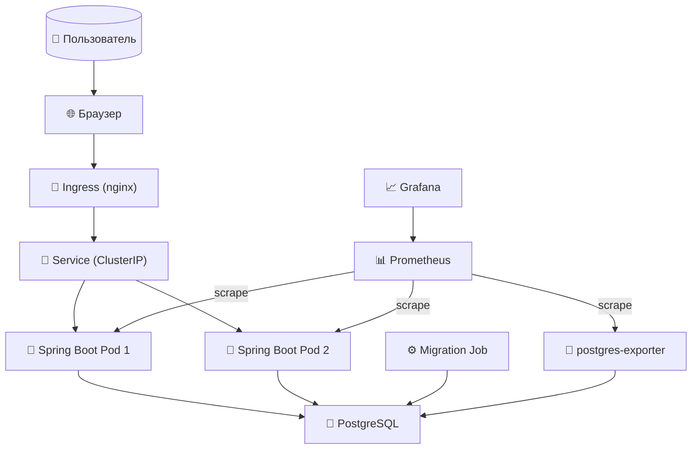
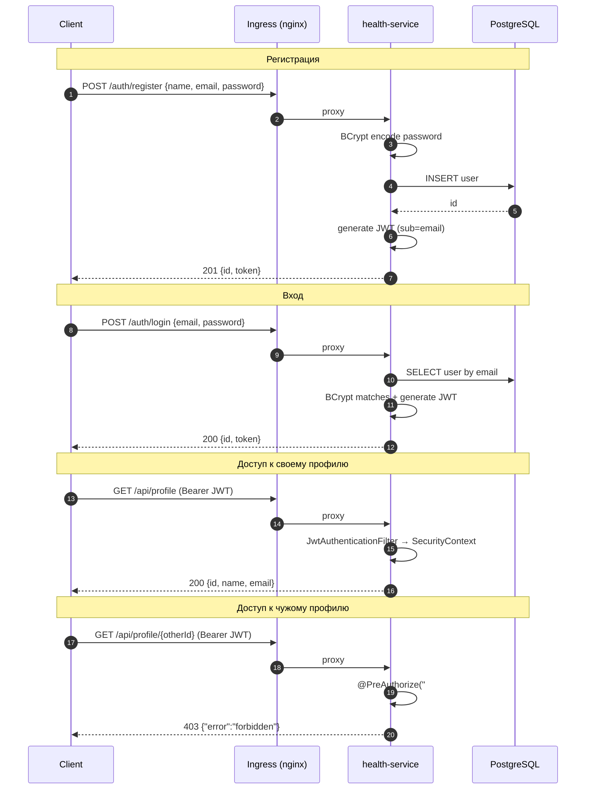
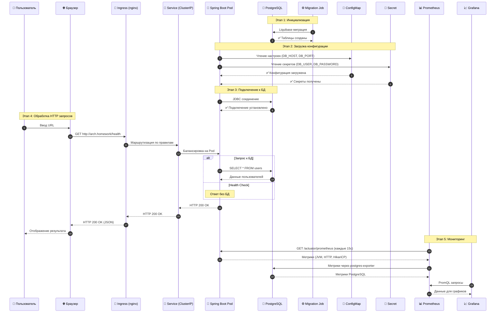

# Health Service

Spring Boot микросервис для управления пользователями с интеграцией PostgreSQL, Liquibase для миграций и полным набором Kubernetes манифестов для развертывания. Включает полный стек мониторинга: Prometheus, Grafana и алертинг.

## 📋 Оглавление
- [Технологии](#технологии)
- [Архитектура](#архитектура)
- [Поток данных](#поток-данных)
- [Мониторинг](#мониторинг)
- [Требования](#требования)
- [Быстрый старт](#быстрый-старт)
- [API Эндпоинты](#api-эндпоинты)

## 🛠 Технологии

### Backend
- **Java 17** — язык программирования
- **Spring Boot 3.2.5** — фреймворк
- **Spring Data JPA** — ORM
- **Spring Web** — REST API
- **Spring Actuator** — мониторинг и health checks
- **Micrometer** — сбор метрик в формате Prometheus
- **Liquibase** — управление миграциями базы данных
- **PostgreSQL** — реляционная база данных
- **Hibernate** — JPA реализация
- **Maven** — сборка проекта

### Инфраструктура
- **Docker** — контейнеризация
- **Kubernetes** — оркестрация
- **Helm** — управление пакетами
- **Nginx Ingress** — маршрутизация трафика
- **Prometheus** — сбор и хранение метрик
- **Grafana** — визуализация и алертинг
- **postgres-exporter** — экспорт метрик PostgreSQL

## 🏗 Архитектура

### Поток аутентификации и доступа к профилю


## Поток данных

    

### Настройка `application.yml`

```yaml
management:
  endpoints:
    web:
      exposure:
        include: health,info,prometheus
  endpoint:
    health:
      show-details: always
    prometheus:
      enabled: true
  metrics:
    tags:
      application: ${spring.application.name}
    distribution:
      percentiles-histogram:
        http.server.requests: true
      percentiles:
        http.server.requests: 0.5, 0.95, 0.99
```

### Установка Prometheus и Grafana

```bash
helm repo add prometheus-community https://prometheus-community.github.io/helm-charts
helm repo update

helm install prometheus prometheus-community/kube-prometheus-stack \
  -n monitoring \
  --create-namespace
```

### Доступ к Prometheus

```bash
kubectl port-forward -n monitoring svc/prometheus-kube-prometheus-prometheus 9090:9090
```

Откройте `http://localhost:9090/targets` — таргет `health-service` должен быть в статусе **UP**.

### Доступ к Grafana

```bash
kubectl port-forward -n monitoring svc/prometheus-grafana 3000:80
```

Пароль администратора:
```bash
kubectl get secret prometheus-grafana -n monitoring -o jsonpath="{.data.admin-password}" | base64 --decode ; echo
```

Откройте `http://localhost:3000` (логин `admin`).

### Импорт дашборда

Дашборд находится в файле `health-service-dashboard.json`. Импортируйте его через **Dashboards → New → Import → Upload JSON file**.

### Панели дашборда

| Панель | Метрики |
|---|---|
| **Latency по API** | P50/P95/P99/Max по эндпоинтам |
| **RPS по API** | Запросы в секунду по эндпоинтам |
| **Error Rate (500)** | Количество 500-х ответов |
| **Latency по NGINX Ingress** | P50/P95/P99 на уровне Ingress |
| **RPS и Error Rate NGINX** | RPS и 5xx от Ingress-контроллера |
| **CPU подов** | `container_cpu_usage_seconds_total` |
| **Memory подов** | `container_memory_working_set_bytes` |
| **PostgreSQL: Connections** | Подключения и транзакции |
| **PostgreSQL: Tuple Ops** | fetched/inserted/updated/deleted |
| **PostgreSQL: DB Size** | Размер базы данных |

### Алертинг в Grafana

Создайте правила в **Alerting → Alert rules → New alert rule**.

**Алерт на Error Rate:**
```promql
sum(rate(http_server_requests_seconds_count{application="health-service", status="500"}[5m]))
```
Условие: `IS ABOVE 5`, Evaluation: `1m`, Pending: `5m`.

**Алерт на Latency:**
```promql
histogram_quantile(0.95, sum(rate(http_server_requests_seconds_count{application="health-service"}[5m])) by (le))
```
Условие: `IS ABOVE 1`, Evaluation: `1m`, Pending: `5m`.

### Установка postgres-exporter

```bash
helm install postgres-exporter prometheus-community/prometheus-postgres-exporter \
  -n health-service \
  -f postgres-exporter-values.yaml
```

Содержимое `postgres-exporter-values.yaml`:
```yaml
config:
  datasource:
    host: "postgres-test-postgresql.health-service.svc.cluster.local"
    user: "app_user"
    pass: "securePassword123"
    port: "5432"
    database: "app_db"
    sslmode: "disable"

serviceMonitor:
  enabled: true
  namespace: monitoring
  labels:
    release: prometheus
```

Проверка:
```bash
kubectl port-forward -n health-service svc/postgres-exporter-prometheus-postgres-exporter 9187:80
curl -s http://localhost:9187/metrics | grep pg_up
```

### Нагрузочное тестирование

```bash
sudo snap install hey
hey -z 5m -c 5 -host "arch.homework" http://localhost:8080/health
```

Во время теста откройте дашборд в Grafana и наблюдайте за графиками.

## 📦 Требования

- **Docker Desktop** с включенным Kubernetes
- **Helm 3+**
- **kubectl**
- **Git** (для клонирования)

### Проверка установки

```bash
docker --version
kubectl version
helm version
```

## Быстрый старт

### Подготовка окружения

Убедитесь, что Kubernetes включен в Docker Desktop:
**Settings → Kubernetes → Enable Kubernetes → Apply & Restart**

### Проверка кластера

```bash
kubectl cluster-info
kubectl get nodes
```

### Установка Ingress Controller

```bash
helm repo add ingress-nginx https://kubernetes.github.io/ingress-nginx
helm repo update

helm install nginx-ingress ingress-nginx/ingress-nginx \
  -n ingress-nginx \
  --create-namespace
```

Проверка:
```bash
kubectl get pods -n ingress-nginx
kubectl get svc -n ingress-nginx
```

### Установка PostgreSQL через Helm

```bash
helm install postgres-test oci://registry-1.docker.io/bitnamicharts/postgresql \
  -n health-service \
  --create-namespace \
  -f values.yaml
```

Проверка:
```bash
kubectl get pods -n health-service
```

### Развертывание приложения

```bash
kubectl apply -f k8s/
```

Или по порядку:
```bash
kubectl apply -f k8s/namespace.yaml
kubectl apply -f k8s/configmap.yaml
kubectl apply -f k8s/secret.yaml
kubectl apply -f k8s/service.yaml
kubectl apply -f k8s/job-migration.yaml
kubectl apply -f k8s/deployment.yaml
kubectl apply -f k8s/ingress.yaml
```

Проверка статуса миграции:
```bash
kubectl logs -n health-service job/db-migration
```

Проверка таблиц в БД:
```bash
kubectl exec -n health-service pod/postgres-test-postgresql-0 -- \
  env PGPASSWORD=securePassword123 psql -U app_user -d app_db -c "\dt"
```

### Настройка Ingress

**Вариант А: Через NodePort**

```bash
NODE_PORT=$(kubectl get svc -n ingress-nginx nginx-ingress-ingress-nginx-controller \
  -o jsonpath="{.spec.ports[0].nodePort}")
echo "Используйте порт: $NODE_PORT"
echo "Доступ: http://arch.homework:$NODE_PORT/health"
```

**Вариант Б: Через Port-Forward**

В отдельном терминале:
```bash
kubectl port-forward -n ingress-nginx svc/nginx-ingress-ingress-nginx-controller 8080:80
```

### Настройка hosts файла

Добавьте в `/etc/hosts` (Linux/macOS) или `C:\Windows\System32\drivers\etc\hosts` (Windows):
```
127.0.0.1 arch.homework
```

## API Эндпоинты

Коллекция Postman находится в директории `etc/collection.json`.

| Метод | Путь | Описание |
|---|---|---|
| GET | `/health` | Health check |
| GET | `/actuator/prometheus` | Метрики в формате Prometheus |
| GET | `/api/users` | Список пользователей |
| POST | `/api/users` | Создать пользователя |
| GET | `/api/users/{id}` | Получить пользователя |
| PUT | `/api/users/{id}` | Обновить пользователя |
| DELETE | `/api/users/{id}` | Удалить пользователя |


Актуальная коллекция Postman для проверки сценария аутентификации и профиля:

- 📄 [`etc/auth-profile-tests.postman_collection.json`](etc/auth-profile-tests.postman_collection.json)
  — 11 запросов, покрывает регистрацию, логин, изоляцию профиля (чтение и редактирование).

Дополнительная коллекция с CRUD пользователей (legacy):

- 📄 [`etc/collection.json`](etc/collection.json)

Запуск через Newman:

```bash
newman run etc/auth-profile-tests.postman_collection.json \
  --env-var "baseUrl=http://arch.homework:8080"
> **Logout:** не реализован на бэкенде, т.к. используется stateless JWT.
> Клиент удаляет токен локально (из localStorage/памяти) — этого достаточно
> для завершения сессии.