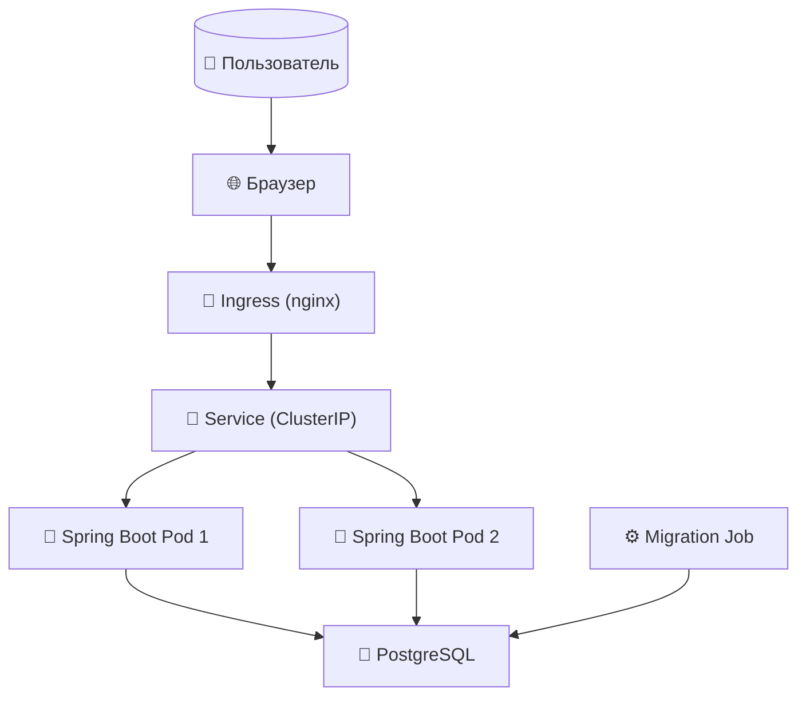
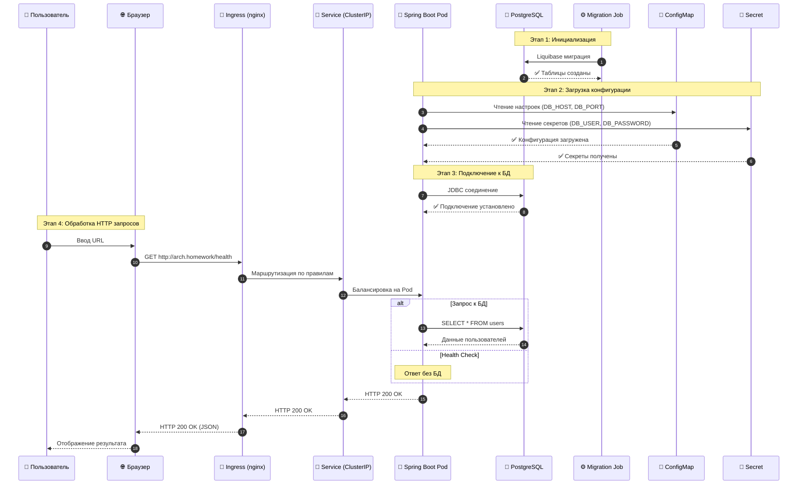

# Health Service

Spring Boot микросервис для управления пользователями с интеграцией PostgreSQL, Liquibase для миграций и полным набором Kubernetes манифестов для развертывания.

## 📋 Оглавление
- [Технологии](#технологии)
- [Архитектура](#архитектура)
- [Поток данных](#поток-данных)
- [Требования](#требования)
- [Быстрый старт](#быстрый-старт)
- [API Эндпоинты](#api-эндпоинты)
## 🛠 Технологии

### Backend
- **Java 17** - язык программирования
- **Spring Boot 3.2.5** - фреймворк
- **Spring Data JPA** - ORM
- **Spring Web** - REST API
- **Spring Actuator** - мониторинг и health checks
- **Liquibase** - управление миграциями базы данных
- **PostgreSQL** - реляционная база данных
- **Hibernate** - JPA реализация
- **Maven** - сборка проекта

### Инфраструктура
- **Docker** - контейнеризация
- **Kubernetes** - оркестрация
- **Helm** - управление пакетами
- **Nginx Ingress** - маршрутизация трафика
- **Prometheus** - сбор метрик (через Micrometer)

## 🏗 Архитектура

## Поток данных

    

## 📦 Требования

- **Docker Desktop** с включенным Kubernetes
- **Helm 3+**
- **kubectl**
- **Git** (для клонирования)

### Проверка установки

powershell
docker --version
kubectl version
helm version

## Быстрый старт
 Подготовка окружения
 Убедитесь, что Kubernetes включен в Docker Desktop
 Settings → Kubernetes → Enable Kubernetes → Apply & Restart

 Проверка кластера

kubectl cluster-info

kubectl get nodes

Установка Ingress Controller
 Добавление репозитория

helm repo add ingress-nginx https://kubernetes.github.io/ingress-nginx

helm repo update

 Установка Ingress Controller

helm install nginx-ingress ingress-nginx/ingress-nginx `

  -n ingress-nginx `

  --create-namespace

 Проверка

kubectl get pods -n ingress-nginx

kubectl get svc -n ingress-nginx

Установка PostgreSQL через Helm

helm install postgres-test oci://registry-1.docker.io/bitnamicharts/postgresql `
  
-n health-service `
  
--create-namespace `
  
-f values.yaml

Проверка

kubectl get pods -n health-service

Развертывание приложения
Применение всех манифестов

kubectl apply -f k8s/

Или по порядку:

kubectl apply -f k8s/namespace.yaml

kubectl apply -f k8s/configmap.yaml

kubectl apply -f k8s/secret.yaml

kubectl apply -f k8s/service.yaml

kubectl apply -f k8s/job-migration.yaml

kubectl apply -f k8s/deployment.yaml

kubectl apply -f k8s/ingress.yaml

Проверка статуса миграции

kubectl logs -n health-service job/db-migration

Проверка таблиц в БД

kubectl exec -n health-service pod/postgres-test-postgresql-0 -- `
  env PGPASSWORD=securePassword123 psql -U app_user -d app_db -c "\dt"

Настройка Ingress

Вариант А: Через NodePort
Получите NodePort

$NODE_PORT = kubectl get svc -n ingress-nginx nginx-ingress-ingress-nginx-controller `
  -o jsonpath="{.spec.ports[0].nodePort}"

Write-Host "Используйте порт: $NODE_PORT" -ForegroundColor Cyan
Write-Host "Доступ: http://arch.homework:$NODE_PORT/health" -ForegroundColor Yellow

Вариант Б: Через Port-Forward
В ОТДЕЛЬНОМ терминале

kubectl port-forward -n ingress-nginx svc/nginx-ingress-ingress-nginx-controller 80:80
 
Настройка hosts файла
 Добавьте в C:\Windows\System32\drivers\etc\hosts:
 127.0.0.1 arch.homework

##  API Эндпоинты
В директории ets collection.json

